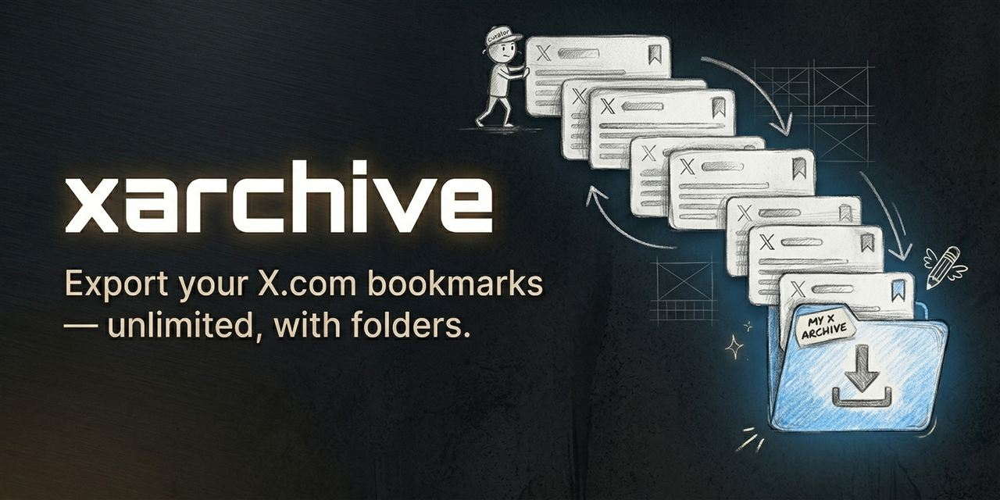

<p align="center">
  
</p>

<h1 align="center">xarchive · Library Fork</h1>

<p align="center"><small>No application-imposed bookmark cap. Collection coverage depends on what X returns.</small></p>

<p align="center">
  <strong>Build and update a personal archive of your X.com bookmarks, including folders.</strong>
</p>

<p align="center">
  <a href="LICENSE"></a>
  
  
  
</p>

---

> **Fork notice:** This is an unofficial fork based on
> [sytelus/xarchive](https://github.com/sytelus/xarchive). The exact upstream
> version and commit are recorded in [release.json](release.json).
> It adds direct synchronization with a self-hosted X Bookmarks Library.
> See [NOTICE.md](NOTICE.md) for attribution and provenance.

**xarchive** is a Chrome extension that collects bookmarks through X.com's internal GraphQL API and maintains a cumulative archive per account. It follows the pages X returns without an application-imposed bookmark cap. Private API changes, rate limits, and unavailable posts can limit collection; the interface reports what was checked and preserves earlier saved content.

## Features

- **Paginated export** -- no application-imposed bookmark count cap
- **Folder assignments** -- includes X Premium bookmark folders
- **Rich data** -- full text, author info, media URLs, engagement metrics, quoted tweets, entities
- **Robust** -- handles long-form tweets, deleted tweets, and visibility-restricted tweets
- **Pause / resume / stop** -- control an open scan and recover collected pages
- **Conservative pacing** -- 2.5s+ pagination delays with automatic backoff
- **Built-in viewer** -- browse your exported bookmarks in a Twitter-like dark UI
- **Cumulative archives** -- merge newer exports without duplicates or losing older saved content
- **Full and quick updates** -- check the entire collection or just recent pages, with explicit coverage
- **Review and undo** -- preview JSON imports, keep accounts separate, and undo the last saved update
- **No build step** -- plain JavaScript with vendored Dexie; no npm install
- **Privacy-first** -- archive processing stays in your browser; no archive uploads or telemetry

## Quick Start

1. **Download and extract the fork package** from the private library onboarding or synchronization panel.
2. **Load in Chrome 120 or newer** -- go to `chrome://extensions/`, enable **Developer mode**, click **Load unpacked**, select the extracted extension folder
3. **Browse X.com** -- visit any page on x.com so the extension can capture auth credentials in the background
4. **Update** -- click the xarchive icon. If you already have an export, use **Import existing JSON**, review it, and save it first. Then click **Full refresh**.
5. **Download** -- when the scan finishes, use **Download combined archive** for all accumulated bookmarks. **Download latest snapshot** contains only that scan's results.

> **How long?** Main pages request up to 100 bookmarks with 2.5–3.75 seconds between pages. Folder pages, network time, and retries add to this. The progress panel shows collected counts and elapsed time; the total is not known in advance.

## Updating the extension

Download the latest fork package into the same extension directory, replace the
packaged files, then go to `chrome://extensions/` and click the refresh icon on
the xarchive card. Releases and source live in the
[X Bookmarks Library repository](https://github.com/sergioframi/x-bookmarks-library).

## Fork release process

`release.json` is the source of truth for upstream provenance and the fork
revision. After changing it, run `scripts/package-extension.sh` from the
companion library project. The packaging command synchronizes `manifest.json`,
`version.js`, `NOTICE.md`, and the downloadable ZIP. Chrome receives a numeric
four-part version while users see `<upstream>-fork.<revision>`.

## Usage Details

### Keeping your archive up to date

The extension keeps a separate cumulative archive for each X account. A new scan adds and refreshes collected bookmarks. It never clears the saved archive. Bookmarks absent from a newer scan remain available; an unavailable tweet keeps previously saved text and media links.

Choose an update mode before starting:

- **Full refresh** checks all bookmark pages and folders. Use this for the first scan and regularly afterward. A reminder recommends a full refresh when none is recorded or the last complete one is over seven days old.
- **Quick update** checks recent bookmark pages until an entire nonempty page contains IDs already in your archive, or pagination ends. The boundary page is refreshed too. This is a shortcut: older changes may be missed, and folders are not checked. It requires an existing, nonempty archive. Nothing runs automatically in the background.

Keep the extension tab open while scanning. **Pause / Resume** works within that tab. **Stop** merges whatever bookmarks were collected and labels the result as partial. Closing the tab stops collection; reopen it and use **Merge collected snapshot** or download that snapshot to recover the staged data. The next scan starts at the beginning. Starting another scan replaces the previous staged snapshot, so recover it first if needed; the saved cumulative archive remains intact.

If saving fails, the previous saved archive remains intact. Download the collected snapshot and retry **Merge collected snapshot**. If another tab updated the archive, reopening/retrying loads its newer revision before merging. Only one extension scan can run at a time.

Pause takes effect before the next request; an in-flight page may finish. Stop interrupts retry/cooldown waits promptly and lets an in-flight request finish or time out (30 seconds). If X returns HTTP 400, 404, or 422, use **Refresh X connection**, then retry. This captures fresh request settings without changing the archive. A changed private API may still require a code update; see [troubleshooting and validation](docs/maintenance.md).

### Moving updates into the viewer

1. **Download combined archive** from the extension (a latest snapshot can also be imported).
2. Open `viewer.html` and choose **Update from JSON**.
3. Review the source account, export date, counts, and collection coverage. Click **Save update** to apply it, or **Cancel** to leave your archive unchanged.
4. Use **Download combined archive** in the viewer for a portable backup.

The extension and viewer maintain independent browser storage. Downloading a file does not automatically update the viewer. Ordinary page refreshes reopen the saved viewer archive; there is no need to clear its cache. **Open another archive** opens or updates that file's account separately. The **Saved archive** selector switches accounts.

Importing the same data twice has no effect and does not consume the undo copy. Older files can add missing history but cannot revert newer observations. **Undo last update** restores the previous saved archive once, including after reopening the page. Downloaded files are unaffected. Save a JSON backup before a sequence of updates if you need longer history.

Legacy exports remain supported. If collection completeness is missing, imports preserve unverified folder assignments. Files without an account ID can be opened separately in the viewer, but cannot be merged or used to update the extension. An unknown export date never authorizes overwriting dated information.

### Controls

| Button | When available | What it does |
|--------|---------------|--------------|
| **Full refresh** | Not scanning | Collects a new full snapshot and merges it into the saved archive |
| **Quick update** | Not scanning; nonempty archive exists | Collects recent pages and merges them; skips folders |
| **Pause** | Exporting | Pauses the current run (can be resumed) |
| **Resume** | Paused | Continues from where it left off |
| **Stop** | Exporting or paused | Ends the run and merges collected bookmarks; snapshot remains downloadable |
| **Import existing JSON** | Not scanning | Reviews and merges a file for the signed-in account |
| **Download combined archive** | Archive saved; not scanning | Downloads the accumulated archive, including retained older bookmarks |
| **Download latest snapshot** | Stopped or complete | Downloads only the latest scan, with its collection coverage |
| **Merge collected snapshot** | Stopped or complete; matching account | Recovers an interrupted scan or retries a failed merge |
| **Undo last update** | A previous saved version exists | Restores that version once |

### Tips

- **Partial downloads** -- stop mid-run and still download everything collected so far.
- **Folders** -- if you have X Premium, folder assignments are included automatically.
- **Re-download** -- combined archives persist across scans and reopening. The latest snapshot persists until you start another scan.
- **Rate limiting** -- the extension uses 2.5s+ delays between requests. If X.com throttles, it backs off automatically.

## Bookmark Viewer

`viewer.html` is a bookmark browser that works independently of the extension. Keep `lib/archive.js` and `lib/viewer-workflow.js` alongside it in their repository paths; no installation or build is required.

**Open it:**
- **Local file** -- open `viewer.html` in a current Chrome or Edge browser and drag-and-drop your JSON file (or click to pick). Other modern browsers may work but need separate verification. Local-file storage behavior varies by browser; retain JSON backups when moving files or changing browsers.
- **From a URL** -- append `?url=<json-url>` to fetch a hosted file and review it before saving:
  ```
  viewer.html?url=https://example.com/bookmarks.json
  ```
  The host must allow browser cross-origin requests when needed. Encode the JSON URL if it contains query parameters. Explicit URLs are fetched again for review even when an archive is already cached; local files use the picker. The viewer no longer requests a hardcoded filename.

**What it offers:**
- Folder sidebar with counts and search filter; a folder selector on small screens
- Full-text search across tweet text, authors, handles, and URLs
- Sort by newest or oldest
- Virtual scrolling -- smooth even with tens of thousands of bookmarks
- Tweet cards with author info, metrics, media, quoted tweets, and folder tags
- Press `/` to jump to the search box
- IndexedDB persistence -- reload without choosing the JSON file again; search is rebuilt
- Import preview with added/refreshed/unchanged/retained counts
- Separate saved accounts, persistent undo, and combined JSON downloads
- Labels for unavailable posts and bookmarks not seen in the last complete full refresh

## How It Works

xarchive uses Chrome's Manifest V3 APIs to passively capture auth headers from your normal X.com browsing, then makes paginated GraphQL requests from the extension's options page. Query IDs are discovered dynamically, with JS bundle scraping as a fallback. Scan data is staged in IndexedDB via [Dexie](https://dexie.org/); cumulative archives and their undo copies are stored separately using atomic IndexedDB transactions.

Both interfaces use the same merge rules, keyed by tweet ID. Folder IDs preserve identity across renames. Successful folder checks refresh assignments; failed or unchecked folders preserve older assignments. Missing bookmarks are retained even after a full scan: API absence does not prove deletion or removal from bookmarks. A “complete” scan means the recognized pagination ended normally, not an independent guarantee that X returned every bookmark. Full, quick, partial, and legacy coverage are distinguished in JSON.

See [incremental archive design and format](docs/incremental-archives.md) for schema, persistence, merge details, and limitations.

See [PLAN.md](PLAN.md) for the current architecture and [FINDINGS.md](FINDINGS.md) for review findings and evidence limits.

## Privacy & Security

- **No archive upload server** -- JSON processing and storage happen locally. Export requests go to X; displayed media may load from its recorded source URLs.
- **No built-in tracking** -- xarchive adds no analytics or telemetry. X and media hosts receive normal browser requests when you collect or view content.
- **Credentials are not exported** -- credentials from your X session are stored locally and used only for requests to X.
- **Open source** -- audit the code yourself.
- **Browser storage is not a backup** -- clearing site/extension data removes its saved copies and undo history. Download combined JSON backups. Media URLs are retained; media files themselves are not downloaded.

## Contributing

Contributions are welcome! For this fork, please
[open an issue](https://github.com/sergioframi/x-bookmarks-library/issues) or
submit a pull request. For the original extension, use the
[upstream project](https://github.com/sytelus/xarchive).

There is no build step: edit the JS files, reload the extension in `chrome://extensions/`, and test. Use Node.js 24 for the automated tests. The repository includes CI on Windows and Linux, issue templates, and a [maintenance guide](docs/maintenance.md). Do not attach personal archive files, cookies, or session headers to public issues.

Run the dependency-free regression tests with `node --test tests/*.test.mjs`. For browser checks, serve the repository locally (`python -m http.server 8000 --bind 127.0.0.1`) and open `http://127.0.0.1:8000/tests/browser-storage.html`. It tests actual IndexedDB using a disposable synthetic database. `tests/extension-fixture.html` exercises the real options UI with synthetic Chrome/X responses and no X requests; add `?scenario=folder-error` or `?scenario=bad-response` for failure cases. Use a fresh localhost port for UI testing so test data does not share storage with a real hosted viewer.

## License

Project code: [MIT](LICENSE). Vendored Dexie 4.0.11: [Apache 2.0](vendor/DEXIE-LICENSE); see [third-party notices](docs/third-party-notices.md).
